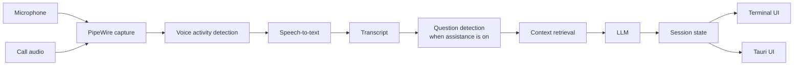

# Daemon (`dmn`)

**A Linux-native, local-first interview copilot for software engineers.**

Daemon listens to a live interview call, transcribes the conversation, detects interviewer questions, and surfaces a short answer scaffold designed to be understood in a few seconds.

The project is built for **mock interviews and interviews where AI assistance is permitted**. It does not join calls as a bot, does not type on the user's behalf, and does not attempt to hide itself from screen sharing. It never speaks unprompted and never speaks words the user did not say or ask for: with `[speak]` on, it speaks the user's own words (or their translation, #109) in the user's own cloned voice, only when the user asks (`dmn speak`, `t` in `dmn run`, or, in translate mode (#114), every sentence the user finishes while they have the mode on).

> **Status:** early development. The foundation CLI is working; the live TUI pipeline and desktop UI are under active development.

## Why Daemon?

Most interview assistants are browser-first, cloud-first, or built around Windows and macOS. Daemon is designed around Linux from the start:

- **Linux-native audio** via PipeWire
- **Local-first** transcription and inference
- **Wayland-first**, with X11 support planned
- **Glanceable output** instead of a scrolling chatbot
- **Low-latency target:** visible guidance within ~2 seconds of a completed question
- **Terminal-first development:** the first live UI is a `ratatui` TUI
- **Desktop UI later:** Tauri 2 over the same Rust session state
- **Provider-agnostic LLM layer:** local Ollama by default, with remote providers optional

## How it works



Daemon keeps the microphone and call audio as separate streams whenever possible, which makes speaker attribution deterministic instead of relying on diarization.

The default interaction is intentionally small:

1. Detect the current question.
2. Extract its intent and focus.
3. Generate a **3–5 line approach**.
4. Show deeper context only when requested.

No wall of text while you're trying to listen to another human.

That assistance is a layer over a live transcriber and translator, and it can be switched off:
press Ctrl+Shift+A during a call, start with `dmn run --no-assist`, or set `[assist] enabled = false`.
Off, Daemon only transcribes (and, with a multilingual model, translates to English) on a
transcript-only screen; no question detection runs and nothing is sent to the LLM. Press
Ctrl+Shift+A again and the next question is answered as usual.

By default only the interviewer's questions (the call's audio) are answered. Set
`[detect] question_source = "you"` or start with `dmn run --question-source you` to have Daemon
answer questions asked on your microphone instead, for asking it directly or for practising with
a mock interview played from a phone; `both` answers either. The setting picks audio streams,
not voices: everything on the mic is "You", so in `you` or `both` your own questions to the
interviewer are answered too. The status line shows `asks: you` or `asks: both`.

Question detection is a set of rules, and it can miss a real question. When it does, press
Enter: the last turn of the asking lane (up to 30 seconds of it) goes to the model as the
question, and the screen updates as it does for a detected one. The asking lane follows
`question_source`: the interviewer by default, your microphone with `you`, and with `both`
whichever of the two spoke last. If the model finds no question in it, the status line says
`not a question` for 5 seconds and nothing else changes.

Every question shown stays within reach for the session: `←` steps back through them, each as
it was when the next one replaced it, and `→` steps forward again. An earlier question holds the
screen (the title says `QUESTION 2 of 5`); questions asked meanwhile are answered behind it, the
status line counts them (`2 new`), and the newest is there when you return. It is read-only:
`1`–`6` open its sections, while `p`, `r` and `w` wait for the live question.

Keys in `dmn run`:

| Key | What it does |
| --- | --- |
| `p` | Pin the question on screen, or unpin it; new questions queue while one is pinned |
| `r` | Answer the question on screen again, from a different angle |
| Enter | Ask about what the asking lane last said (the interviewer, by default), when the detector missed the question |
| `1`–`6` | Open or close one of the six sections under the Approach |
| `↑` `↓`, PgUp, PgDn | Scroll the open section when it is taller than the screen: a row, or the rows on screen |
| Mouse wheel | Scroll the open section, three rows a notch, with the pointer on the left column (`[ui].mouse`, on by default) |
| Left click on a section row | The same as its number key. `mouse = false` gives the mouse back to the terminal (text selection) |
| `←` `→` | Show the question before the one on screen, or the one after; `→` from the newest earlier one returns to the live question |
| `w` | Swap the STAR story of a behavioral question |
| `s` | Coding solutions: hints ↔ full |
| `m` | Mute or unmute your microphone |
| `t` | With `[speak]` on: translate what you last said into `[speak].target` and speak it in your cloned voice into `dmn-voice` (below, § Speak) |
| `l` | With `[speak]` on: switch `dmn-voice` between your own voice, live (the default), and translate mode, where every sentence you finish goes out translated (#114, below) |
| Ctrl+Shift+A | Interview assistance on ↔ off |
| `q`, Esc, Ctrl+C | Quit |

## Current CLI

The `dmn` CLI currently includes:

```text
dmn doctor [--init | --probe | --fetch small.en|small|silero]
dmn config show
dmn devices
dmn run [--mic NODE] [--app APP]          # live: your mic + the call's audio, until q
dmn run --no-assist                       # transcribe / translate only; a turns assistance on
dmn run --question-source you|both        # answer questions from your mic, or from either stream
dmn run --replay INTERVIEWER.wav CANDIDATE.wav [--headless]
dmn replay INTERVIEWER.wav CANDIDATE.wav [--speed N]
dmn bench [--live [--session ID]]          # whisper speed; or latency + CPU of a stored session
dmn sessions list | export ID | purge ID|all
dmn speak enroll --wav CLIP.wav [--name N] [--language es]   # register your voice with the TTS server
dmn speak "TEXT"                          # speak TEXT in your cloned voice into the virtual mic dmn-voice
dmn speak "TEXT" --out FILE.wav           # or write it to a WAV file instead
```

`dmn sources` (context documents) arrives with M2.

## Quick start

### Requirements

Daemon currently targets Ubuntu 24.04 / Pop!_OS 24.04-class Linux systems.

Install the build dependencies:

```bash
sudo apt install libpipewire-0.3-dev clang libclang-dev cmake just
```

You will also need:

- Rust 1.85+ (the repository includes `rust-toolchain.toml`)
- PipeWire 1.0+
- `pw-record`, `pw-play`, and `pw-dump`
- Ollama if you want local LLM inference

### Build

```bash
git clone https://github.com/njdaniel/daemon.git
cd daemon

just build
```

The release binary is written to:

```text
target/release/dmn
```

#### Optional: whisper on the GPU

Whisper runs on the CPU unless you ask for the GPU. With an NVIDIA GPU, a Vulkan build can run
the interviewer's whisper on the GPU, which cuts the transcription step on the question →
Approach path from about 0.8 s to about 0.35 s (#61, measured on an RTX 4090 beside
`qwen3.6:35b-a3b`). Install the Vulkan headers and shader compiler, and `just build` includes
GPU support from then on (it says which it built):

```bash
sudo apt install libvulkan-dev glslc vulkan-tools
just build           # cpu + gpu when those are installed, else cpu only
just build cpu       # force the plain build; `just build gpu` forces Vulkan
```

The Vulkan binary still transcribes on the CPU by default. Choose the GPU per run with
`dmn run --device gpu`, or for every run with `[stt].device` below. By hand, the build is
`cargo build --release -p dmn-cli --features vulkan`. (`--features cuda` works too, with the
CUDA toolkit on `PATH`; it measured no faster here.)

Whisper only fits beside a large local model when the model's context is smaller than
Ollama's default, so set both in `~/.config/dmn/config.toml`:

```toml
[stt]
device = "auto"      # the GPU when it has room, else the CPU; "gpu" warns when it falls back

[llm]
num_ctx = 8192       # Ollama context dmn asks for; frees the VRAM whisper needs
```

`dmn doctor` lists the GPUs the build sees and where whisper would run; the status line shows
`stt gpu+cpu` when the interviewer's lane is on the GPU and yours on the CPU (the usual split
on a 24 GB card). Changing `num_ctx` makes Ollama reload the model (about 6 s), and any other
tool that uses Ollama's default context reloads it again (about 11 s).

#### Interviews in another language

Whisper's `.en` models only transcribe English. For a call held in another language, fetch a
multilingual model and switch the language mode:

```
dmn doctor --fetch small
```

```toml
[stt]
model = "small"       # or medium / large-v3; the .en files and large-v3-turbo cannot translate
language = "auto"     # detect each utterance's language and translate it to English; or a code such as "es"
```

Both lanes then arrive in English (whisper translates as it transcribes), so questions are
detected, answered and shown exactly as for an English call; the transcript tags what was heard
(`Interviewer (es→en):`) and the status line shows `es→en`. `--language` on `dmn run`, `dmn
replay` and `dmn bench` overrides the config for one run. Keep `language = "en"` with `small.en`
for English calls: the multilingual `small` is a little less accurate on English and pays a
detection step per utterance.

To follow a call (or a video) in another language without the interview aid, run
`dmn run --no-assist --language auto --model small`: the screen is the translated transcript
alone. With a local Ollama the model is unloaded at start, so a GPU build can give whisper the
whole card (`--model medium` runs at about 0.14 s per utterance on a 4090). Pressing
Ctrl+Shift+A later loads the LLM into what is left; if a tenth or more of it lands in system
memory the status line says `llm partly on cpu`.

#### Checking answers that depend on what is current (web lookup, off by default)

A local model only knows what it was trained on. Asked for "the latest stable version of Go",
it hedges and tags the Approach `may be out of date` (#101). With the web lookup on, Daemon
then searches the web for that one question and answers again from what it finds (#102): the
first Approach still arrives from the local model alone, and a few seconds later it is replaced
in place by one built on the results, tagged `checked · go.dev`. If the search times out, fails,
finds nothing or has no key, the first answer stays and the status line says `lookup failed`.

It can search through your own [SearXNG](https://docs.searxng.org/) instance (no account, no
key; the query goes to your instance, which forwards it to the engines it is set up with) or
through [Ollama's web search](https://docs.ollama.com/capabilities/web-search) (a key from your
ollama.com account).

With SearXNG on this machine (its Docker image listens on port 8888), allow its JSON output by
adding `json` to `search.formats` in its `settings.yml` (a stock instance answers 403 until you
do), then:

```toml
[lookup]
enabled = true
provider = "searxng"
# base_url = "http://localhost:8888"   # the default for searxng
# timeout_ms = 6000                    # the default for searxng when left out
```

With Ollama's search instead, export the key, then turn the lookup on:

```bash
export OLLAMA_API_KEY=...        # the key stays in the environment; dmn never writes or logs it
```

```toml
[lookup]
enabled = true
# provider = "ollama"; base_url = "https://ollama.com"; api_key_env = "OLLAMA_API_KEY"
# timeout_ms = 3000; max_results = 5
```

`dmn doctor` says whether it is off, ready, or on with the variable unset (for SearXNG: whether
the instance answers, and whether its JSON format is off), and the status line
says `web` beside the model dot while it is on. What it sends, and to whom, is under Privacy.

#### Speak in your cloned voice (`dmn speak`, off by default)

`dmn speak` synthesizes text in a clone of your own voice, from a 10–30 s recording of you, through
a text-to-speech server on this machine (#107), and plays it into a virtual microphone named
`dmn-voice` that the call selects as its microphone (#108), so the interviewer hears it and your
own speakers stay silent. In `dmn run`, `t` translates what you just said into the interview's
language and speaks that (#109, below).

The server is [chatterbox-tts-api](https://github.com/travisvn/chatterbox-tts-api), an
OpenAI-compatible server around Resemble AI's [Chatterbox](https://github.com/resemble-ai/chatterbox)
model (zero-shot voice cloning, 22 languages in its multilingual model). You run it yourself, like
Ollama; Daemon only talks to it over HTTP. With Docker, on the CPU:

```bash
git clone https://github.com/travisvn/chatterbox-tts-api && cd chatterbox-tts-api
cp .env.example.docker .env            # then set DEVICE=cpu in .env
# The stock compose file publishes port 4123 on every interface; keep it on this machine:
cat > docker/docker-compose.dmn.yml <<'EOF'
services:
  chatterbox-tts:
    ports: !override
      - '127.0.0.1:4123:4123'
    environment:
      - USE_MULTILINGUAL_MODEL=true
EOF
docker compose -f docker/docker-compose.cpu.yml -f docker/docker-compose.dmn.yml up -d --build
curl -s http://localhost:4123/health    # "status": "healthy" once the model has downloaded and loaded
```

The first start downloads the model, which takes a while. On the dev box's CPU (Ryzen 7700X) one
sentence (about 4 s of speech) takes 11–14 s to render, roughly 3× slower than real time. `dmn
speak` plays from the server's streaming route, so the first sentence is heard while the next
renders; measured 2026-10-06 for "Gracias por la oportunidad." (2.3 s of speech), the call hears
the first sound 7.9–8.8 s after the command starts and the last 10.3–11.2 s after it. That wait is
the server's; the virtual microphone adds about 0.1 s.

**On the GPU (#113).** The GPU server renders about 3× faster than real time instead of 3–5×
slower: on the dev box's RTX 4090, 1.9 s for 6.3 s of German and 2.2 s for 7.6 s of Russian (the
CPU took 25.7 s for 9.6 s). It needs Docker's NVIDIA runtime, a one-time host step (the driver must
already be installed; `nvidia-smi` works):

```bash
sudo apt install nvidia-container-toolkit
sudo nvidia-ctk runtime configure --runtime=docker
sudo nvidia-ctk cdi generate --output=/etc/cdi/nvidia.yaml
sudo systemctl restart docker
# then, in the chatterbox-tts-api clone, the GPU compose file in place of the CPU one
# (the same volumes, so voices already enrolled carry over):
docker compose -f docker/docker-compose.gpu.yml -f docker/docker-compose.dmn.yml up -d --build
curl -s http://localhost:4123/health    # "device": "cuda"
```

The server holds about 4 GB of VRAM. The default LLM (`qwen3.6:35b-a3b`) takes about 22 of the
4090's 24 GB, so the two do not both fit: with the TTS server on the GPU, `dmn run` with assistance
on finds the answer model partly on the CPU (measured: 74 % of it on the GPU, translation p50 0.68 s
instead of 0.37 s, and answers slower). The translation-only setup below keeps that model out of
memory. `dmn doctor` reports the server's device, with this way to the GPU when it is `cpu`; the
first request after the server starts takes several seconds longer (8.9 s against 1.9 s, CUDA
warming up), so `dmn run` sends it one word at start, whose audio goes nowhere. `[speak].device`
records your choice for this setup; dmn does not read it.

Then turn speak on, enroll a clip of your voice, and speak:

```toml
[speak]
enabled = true
target = "es"                         # the language `t` speaks; enroll the voice with the same --language
# tts_url = "http://localhost:4123"   # the default; it must be on this machine
```

`target` has no default, and `enabled = true` without it is a config error naming the key.

```bash
# A WAV of you speaking for at least 6 s (10-30 s is better), mono 16 kHz or more preferred.
# --language is the language the voice will speak (the server ties it to the voice); default en.
dmn speak enroll --wav ~/my-voice.wav --language es
dmn speak "Buenas tardes, gracias por la oportunidad."                       # into dmn-voice
dmn speak "Buenas tardes, gracias por la oportunidad." --out /tmp/dmn-speak.wav   # or to a file
```

`enroll` checks the clip (a WAV, at least 6 s, at most 10 MB; a stereo or sub-16 kHz clip works,
with a note), registers it with the server under its name (`voice` unless `--name` says otherwise;
enrolling a name again replaces that voice), keeps a copy at `~/.local/share/dmn/<name>.wav`, and
sets `[speak].voice_ref` to that copy in your config, editing that one line and leaving the rest
of the file as it was. `dmn speak` checks the voice is still in the server's library before asking
for speech (the server would otherwise answer in its default voice) and says how to enroll it again
if not.

**The virtual microphone.** Without `--out`, `dmn speak` creates a PipeWire source node named
`dmn-voice` (shown as "Daemon voice (dmn speak)"), plays the speech into it, and removes it when
the command ends. In the call, pick **dmn-voice** as the microphone: in Meet, Zoom or Teams it is in
the microphone list beside your real one, and in the desktop's sound settings it is a new input
device. The call then transmits the cloned voice; your own speakers and headphones stay silent, and
your real microphone is not touched. The node exists only while the command runs, so start the
command and then select it (the server's render time leaves several seconds for that), or select
it in a call before a second `dmn speak`; a session that speaks repeatedly (#109) can keep one node
open for its whole run. If nothing has selected `dmn-voice`, PipeWire does not pull from it. The
speech is queued in a 2 s buffer: a phrase that fits waits its own length plus 2 s for a listener,
then the command finishes with exit 0 and reports how much was never played; a longer one (most sentences,
including the 2.3 s example above) fills the buffer, waits 5 s for something to pull, and the
command exits 1 with `nothing pulled from dmn-voice for 5 s … is it selected as the microphone
anywhere?`. To check from a terminal:

```bash
dmn speak "Gracias por la oportunidad." &
pw-dump | grep -c '"node.name": "dmn-voice"'     # 1 while the command runs, 0 afterwards
pw-record --target dmn-voice /tmp/vmic.wav       # what the call hears; Ctrl-C when the command ends
pw-play /tmp/vmic.wav                            # intelligible, right speed, your voice
```

Without a running PipeWire server the command says so and suggests `--out`; nothing panics.

**`t` in `dmn run`: say it in your language, the interviewer hears it in theirs (#109).** With
`[speak].enabled` and `target`, `dmn run` opens `dmn-voice` when it starts and keeps it for the
whole session, so select it as the call's microphone once, before you need it. Say something
(in English, say), then press `t`: your last turn (what you said since the interviewer last spoke,
up to 30 s) is translated into `target` by `[speak].model` (left out: the `[llm]` model the
answers use; see translation only, below), synthesized in your enrolled voice, and played into
`dmn-voice`. The status line shows `translating… 0s`, then
`speaking… 9s` with the seconds since the key, and the translation sits as one dim line (`» …`)
at the foot of the question block until it has played. The keys end with `t speak` while it is on.
`t` works with assistance off (Ctrl+Shift+A), does nothing while `[speak]` is off, and does
nothing while a press is still in flight. Before you have said anything it says `nothing to
speak`; a failed translation, a TTS server that went away, or a `dmn-voice` nothing has selected
is said in amber for 5 s, and nothing else changes.

Translation on the local model adds well under a second (0.35–0.49 s for one sentence on the dev
box, measured 2026-10-06); the CPU TTS server is the wait. For "I would start with a token bucket
for each API key and keep the counters in Redis." (6.5 s of Spanish), the call heard the first
sound 18.0–18.7 s after `t` and the last 24.5–25.5 s after it, and a three-line turn 43–62 s.
With the TTS server on the GPU and the small translator below (measured 2026-10-08, German), the
same sentence is heard 2.5–2.8 s after `t` (translation 0.34–0.40 s) and a three-sentence turn
1.8–2.1 s after it: dmn asks the server for one sentence at a time, so the first is heard while
the rest render (the whole turn in one request took 4.1–4.2 s to its first sound).

**Translation only: a small translator, the answer model left out (#113).** If you only want `t`
(no interview help), give translation a small model of its own and start with assistance off:

```toml
[assist]
enabled = false                       # or `dmn run --no-assist`

[speak]
enabled = true
target = "de"
model = "llama3.1:8b"                 # `ollama pull llama3.1:8b` (4.6 GB); left out: [llm].model
```

With assistance off at start and `[speak].model` set, `dmn run` asks Ollama to drop `[llm].model`
and never loads it; the translator (about 5.4 GB) is loaded at start, and whisper and the GPU TTS
server share the rest. Ctrl+Shift+A loads `[llm].model` when you turn assistance on, as before;
with assistance on both models are loaded, and the status line says `llm partly on cpu` when the
GPU is short. `dmn doctor` names the translator and says whether Ollama has it.

The small model is about twice as fast and noticeably rougher. Measured 2026-10-08 on 10 interview
sentences into German and Russian (dmn's own prompt, temperature 0): `llama3.1:8b` took 0.30 s
p50 against 0.68 s for `qwen3.6:35b-a3b` (partly on the CPU beside the TTS server). It answered
nothing and added nothing but one pair of quotes, but made grammar slips in about half the German
sentences ("das Engpass", "einer Dutzend", "shardet") and two meaning errors in the Russian
("bootstrap" for "bottleneck", "paid" for "paying"), where `qwen3.6:35b-a3b` made no German
errors and added one phrase to one Russian sentence ("the implementation of" a token bucket). For
short, plain sentences it is fine; for anything that must land exactly, keep `[speak].model`
unset and the answer model loaded.

**A reply that is not a translation is never spoken (#117).** On a fragment ("And no input.") a
small model sometimes stops translating and answers as if it were you: in a live call on
2026-10-08, `llama3.1:8b` turned "Back to English. And no input." into "I'm a quick learner and I
can pick up new things fast. I've been working with computers for years, so I think I'd be a good
fit for this job.", in English, and dmn spoke it in the Russian voice. Now every reply is checked
against your turn before anything is synthesized: one longer than 2.5× your words plus 20
characters, or not written in the target's script (Cyrillic for `ru`, kana for `ja`, and so on;
Latin-script targets get only the length rule), is dropped. The press ends with `translate
failed: off-script reply` on the status line for 5 s, the reply goes to the log, and nothing
reaches the call; press `t` again. The prompt also no longer tells the model whose words they
are or where they were said, which is what gave it a role to play.

**The noise after a sentence (#113).** The TTS model sometimes ends a sentence with a second of
silence and then a loud burst of noise. dmn asks the server for one sentence at a time and stops
each one at the first 0.8 s of near-silence after its speech, keeping 0.3 s of it, so the burst
never reaches the call (or `dmn speak --out`'s file). Lower sampling temperature makes the burst
rarer, and dmn sends `[speak].temperature = 0.6` by default (the server's own is 0.8); `cfg_weight`
(pace, 0.0–1.0) and `exaggeration` (emotion, 0.25–2.0) are sent when you set them:

```toml
[speak]
temperature = 0.6                     # 0.05-5.0
# cfg_weight = 0.5
# exaggeration = 0.5
```

**Your own voice through `dmn-voice`, and translate mode (#114).** With `dmn-voice` as the
call's microphone, the call hears your real voice, live, from the moment `dmn run` starts:
your microphone (`[audio].mic`, the one whisper hears) passes through the node. This is
**pass-through mode**, the default, and `t` is as above: your last turn goes out translated over
it (your voice fades out under the sentence's first 8 ms and back in after it; the call never
hears both). Press `l` for **translate mode**: your microphone is shut off from the call and every
sentence you finish (each turn whisper finalizes; two finals that arrive while one is still being
spoken go out as one) is translated into `target` and spoken in your cloned voice instead, in
order, one at a time; a turn that arrives while another is speaking waits its turn. `t` in
translate mode speaks the last turn again (for when the automatic one failed). `l` again drops
whatever is waiting (not what is playing) and lets your own voice through again.
`[speak].mode = "passthrough" | "translate"` is the mode at start (default `passthrough`).

You always know which the call is hearing: the status line opens with a wide coloured tag,
`voice: you (en)` in pass-through mode (magenta, your voice's colour) and `voice: → de` in
translate mode (teal, amber while a turn is being translated or spoken); the keys end with
`l translate` or `l own voice` where the line has room. In the transcript a line that went out
translated reads `You → de`, with the translation dim on the row under it, so you can read back
what the call heard, and each switch writes one dim marker row (`— translate mode on: → de —`).
All of it on the transcript-first screen with assistance off too.

Pass-through adds no audible delay. The microphone is captured a second time at the graph rate
(the whisper lane runs at 16 kHz, which would cut the call to telephone bandwidth) and its
samples go from PipeWire's capture callback straight into the node's playback callback through a
lock-free ring, no thread in between: measured 2026-10-08 with `just probe` (a 440 Hz tone played
by `pw-play` into the capture, `pw-record` on `dmn-voice`), 0.0–0.1 ms inside dmn and 21.4 ms to
`pw-record`'s pipe, one 1024-sample quantum, which is `pw-record`'s own buffering. The tone came
out at 440 Hz and its full length; the mic's clock and the call's drifting apart is absorbed by
skipping a backlog over 60 ms down to 20 ms. Translate mode's delay is the sentence's: the VAD's
0.4 s, whisper, the echo guard's hold on a mic final (up to 1.5 s, `[audio].echo_guard`), then
#113's translation and rendering, so with the GPU server a sentence is heard a few seconds after
you finish it.

**After a restart, select `dmn-voice` again.** Each `dmn run` creates a new `dmn-voice` node.
PipeWire links an app back to it only when the app names the device in its own stream (`pw-record
--target dmn-voice` does) and nothing else played or recorded while dmn was down; Discord (and
other Chromium-based apps that pin a chosen microphone) and a stream you moved by hand in the sound
settings stay on the old node's choice, and no setting of the node changes that (#113, measured
with `just probe`). So a moment after start, when nothing
is linked to `dmn-voice`, the status line says `Discord: re-select dmn-voice as the microphone`
for 5 s; a press nothing heard says the same.

At start-up, `dmn run` checks what a press would need and could not fix mid-call: the TTS server
answers, your voice is in its library, and the voice speaks `target` (the server speaks each voice
only in the language it was enrolled with). A voice enrolled for another language is an error
naming both and the fix: `dmn speak enroll --wav <clip> --language es`. One enrolled voice per
language; switching languages means re-enrolling.

With `[stt].language = "auto"` (or a code, for an interview in another language), whisper
translates both lanes into English. With `[speak]` on, the **You** lane is the exception: it
detects your language and keeps your own words, so `t` translates what you said rather than
whisper's English version of it. Use headphones: the mic lane is no longer translated, so a mic
that hears the call would show the interviewer's own-language words as yours.

### Initialize and inspect your system

```bash
target/release/dmn doctor --init
target/release/dmn doctor
target/release/dmn devices
```

The default config lives at:

```text
~/.config/dmn/config.toml
```

### Use headphones

Daemon tells you and the interviewer apart by where the audio comes from: your microphone is
**You**, the call app's output is **Interviewer**. Nothing listens for voices, so that split only
holds while each voice reaches Daemon through one path.

With headphones it does. With speakers, the interviewer's voice plays out loud and your
microphone picks it up again. Daemon then hears every interviewer sentence twice, once on the
call's stream and once on your mic, and the mic copy is transcribed as **You**:

- The interviewer's words show up in your transcript lines, and go to the model as if you had
  said them.
- The detector scores only Interviewer lines, so it does not answer the echo itself, but every
  interviewer sentence now looks answered at once (a You line right after it is one of the
  detector's cues for a question), so statements get flagged as questions more often.

The echo guard (`[audio].echo_guard`, dropping mic text that duplicates the call within 300 ms)
is planned for M2 and is not active yet. Until then:

- Wear headphones, or earbuds, for any call you run Daemon beside.
- A laptop or conference speakerphone with hardware echo cancellation helps, but check it (below)
  before relying on it.

To check your setup:

```bash
dmn devices              # your mic (* = default) and the apps playing audio right now
dmn doctor --probe       # plays a quiet 440 Hz tone and captures it back through the app stream,
                         # the sink monitor and pw-record (about 3 s of sound)
dmn run                  # talk for a few seconds, then play a video with speech:
                         # the video should show as Interviewer only, never as You
```

If the call's speech shows up as **You** in `dmn run`, the mic is hearing your speakers: switch to
headphones. If nothing shows as **Interviewer**, name the call app with `--app` (the
`application.name` from `dmn devices`, e.g. `--app Firefox`), or `--app ""` to capture all system
audio. Run `dmn bench --live` after a call to see its latency and CPU use; the status line's red
**N dropped** means audio was lost because the machine fell behind.

## Development

The project uses `just` as its task runner.

```bash
just check     # cargo check --workspace --all-targets
just test      # cargo test --workspace
just lint      # clippy + rustfmt check
just build     # release build of dmn; with GPU whisper when libvulkan-dev + glslc are installed
just probe     # ignored tests that need a live PipeWire server
just eval      # offline evaluation harness
```

Replay fixtures are also supported by the development harness as the pipeline is implemented:

```bash
just replay sysdesign
```

## Repository layout

```text
apps/
  dmn-cli/          CLI and terminal application

crates/
  dmn-audio/        PipeWire capture and audio sources
  dmn-vad/          voice activity detection
  dmn-stt/          speech-to-text
  dmn-transcript/   transcript types and processing
  dmn-detect/       question detection
  dmn-context/      resume / job / notes retrieval
  dmn-llm/          Ollama and remote LLM providers
  dmn-tts/          text-to-speech in your cloned voice via a local TTS server
  dmn-session/      live session state
  dmn-store/        persistence
  dmn-core/         pipeline orchestration

docs/
  SPEC.md           product and architecture specification
  PROCESS.md        development process
  DEPENDENCIES.md   dependency decisions
  design/           UI design material
  issues/           issue specifications

eval/               offline evaluation harness
testdata/           mock-interview fixtures
```

## Design principles

### Glanceable

The default answer surface should be readable in **2–5 seconds**. Daemon prefers a handful of useful lines over a complete essay.

### Local first

Audio is intended to stay on the machine. Transcript text is only sent to a remote model when the user explicitly configures one.

### Deterministic where possible

Audio capture, segmentation, speaker attribution, and initial question detection are handled in code. The LLM is used where interpretation is actually useful.

### User remains in control

Daemon surfaces context and suggestions. The user decides what to say.

## Privacy

Daemon is being designed with privacy as a core constraint:

- audio is not written to disk by default
- local transcription is the default architecture
- Ollama is the default LLM provider
- remote providers are opt-in
- no accounts, telemetry, or cloud sync are required for v1

What leaves the machine, and when:

- **Audio:** never.
- **Transcript text** (with the retrieved notes and the session summary): only when you choose a
  remote model (`[llm].provider` other than `ollama`, or an Ollama on another host).
- **A web search query:** only with the web lookup on (`[lookup].enabled = true`; off by
  default). For a question whose answer depends on what is current, the few words the model
  writes as a search query (at most 80 characters, such as `latest stable Go release`) goes to
  the search you chose. With `provider = "searxng"`: to your own SearXNG instance
  (`http://localhost:8888` by default), with no account or key; your instance then forwards it
  to the search engines it is configured with. With `provider = "ollama"`: with the number of
  results wanted, to Ollama's web search at `https://ollama.com/api/web_search`, with your key
  from `OLLAMA_API_KEY`. No transcript, no resume or notes, nothing from the session goes with
  it.
- **Text to speak, and your voice clip:** only to the TTS server at `[speak].tts_url`, which
  `dmn speak` requires to be on this machine (it refuses any other host). `dmn speak "text"` sends
  the text; `dmn speak enroll` uploads your clip once, and the server keeps it in its voice
  library (delete it there with `curl -X DELETE http://localhost:4123/v1/voices/<name>`). `t` in
  `dmn run` sends your last turn to the `[llm]` provider for translation (localhost Ollama by
  default; with a remote provider it leaves the machine exactly as the transcript window already
  does), then the translation to the same TTS server.

Audio on disk: the call is never recorded unless `[privacy].record_audio = true`. `dmn speak`
writes audio only where its own command line names: `--out FILE.wav` writes the synthesized
speech there, and `enroll --wav CLIP` keeps a copy of your clip at
`~/.local/share/dmn/<name>.wav`.

## Roadmap

The project is being built in stages:

- **Foundation** — configuration, diagnostics, PipeWire device discovery
- **Terminal MVP** — live capture, VAD, transcription, question detection, TUI
- **Context + quality** — resume/job context, retrieval, better detection, evaluation
- **Desktop** — Tauri 2 floating window using the same Rust session state

See [docs/SPEC.md](docs/SPEC.md) for the detailed design and build plan.

## Documentation

- [Design spec and build plan](docs/SPEC.md)
- [Development process](docs/PROCESS.md)
- [Dependency decisions](docs/DEPENDENCIES.md)
- [Claude Code project instructions](CLAUDE.md)

## License

MIT.
