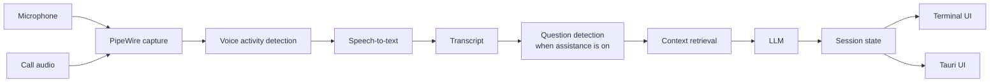

# Daemon (`dmn`)

**A Linux-native, local-first interview copilot for software engineers.**

Daemon listens to a live interview call, transcribes the conversation, detects interviewer questions, and surfaces a short answer scaffold designed to be understood in a few seconds.

The project is built for **mock interviews and interviews where AI assistance is permitted**. It does not join calls as a bot, type or speak on the user's behalf, or attempt to hide itself from screen sharing.

> **Status:** early development. The foundation CLI is working; the live TUI pipeline and desktop UI are under active development.

## Why Daemon?

Most interview assistants are browser-first, cloud-first, or built around Windows and macOS. Daemon is designed around Linux from the start:

- **Linux-native audio** via PipeWire
- **Local-first** transcription and inference
- **Wayland-first**, with X11 support planned
- **Glanceable output** instead of a scrolling chatbot
- **Low-latency target:** visible guidance within ~2 seconds of a completed question
- **Terminal-first development:** the first live UI is a `ratatui` TUI
- **Desktop UI later:** Tauri 2 over the same Rust session state
- **Provider-agnostic LLM layer:** local Ollama by default, with remote providers optional

## How it works



Daemon keeps the microphone and call audio as separate streams whenever possible, which makes speaker attribution deterministic instead of relying on diarization.

The default interaction is intentionally small:

1. Detect the current question.
2. Extract its intent and focus.
3. Generate a **3–5 line approach**.
4. Show deeper context only when requested.

No wall of text while you're trying to listen to another human.

That assistance is a layer over a live transcriber and translator, and it can be switched off:
press Ctrl+Shift+A during a call, start with `dmn run --no-assist`, or set `[assist] enabled = false`.
Off, Daemon only transcribes (and, with a multilingual model, translates to English) on a
transcript-only screen; no question detection runs and nothing is sent to the LLM. Press
Ctrl+Shift+A again and the next question is answered as usual.

By default only the interviewer's questions (the call's audio) are answered. Set
`[detect] question_source = "you"` or start with `dmn run --question-source you` to have Daemon
answer questions asked on your microphone instead, for asking it directly or for practising with
a mock interview played from a phone; `both` answers either. The setting picks audio streams,
not voices: everything on the mic is "You", so in `you` or `both` your own questions to the
interviewer are answered too. The status line shows `asks: you` or `asks: both`.

Question detection is a set of rules, and it can miss a real question. When it does, press
Enter: the last turn of the asking lane (up to 30 seconds of it) goes to the model as the
question, and the screen updates as it does for a detected one. The asking lane follows
`question_source`: the interviewer by default, your microphone with `you`, and with `both`
whichever of the two spoke last. If the model finds no question in it, the status line says
`not a question` for 5 seconds and nothing else changes.

Every question shown stays within reach for the session: `←` steps back through them, each as
it was when the next one replaced it, and `→` steps forward again. An earlier question holds the
screen (the title says `QUESTION 2 of 5`); questions asked meanwhile are answered behind it, the
status line counts them (`2 new`), and the newest is there when you return. It is read-only:
`1`–`6` open its sections, while `p`, `r` and `w` wait for the live question.

Keys in `dmn run`:

| Key | What it does |
| --- | --- |
| `p` | Pin the question on screen, or unpin it; new questions queue while one is pinned |
| `r` | Answer the question on screen again, from a different angle |
| Enter | Ask about what the asking lane last said (the interviewer, by default), when the detector missed the question |
| `1`–`6` | Open or close one of the six sections under the Approach |
| `↑` `↓`, PgUp, PgDn | Scroll the open section when it is taller than the screen: a row, or the rows on screen |
| Mouse wheel | Scroll the open section, three rows a notch, with the pointer on the left column (`[ui].mouse`, on by default) |
| Left click on a section row | The same as its number key. `mouse = false` gives the mouse back to the terminal (text selection) |
| `←` `→` | Show the question before the one on screen, or the one after; `→` from the newest earlier one returns to the live question |
| `w` | Swap the STAR story of a behavioral question |
| `s` | Coding solutions: hints ↔ full |
| `m` | Mute or unmute your microphone |
| Ctrl+Shift+A | Interview assistance on ↔ off |
| `q`, Esc, Ctrl+C | Quit |

## Current CLI

The `dmn` CLI currently includes:

```text
dmn doctor [--init | --probe | --fetch small.en|small|silero]
dmn config show
dmn devices
dmn run [--mic NODE] [--app APP]          # live: your mic + the call's audio, until q
dmn run --no-assist                       # transcribe / translate only; a turns assistance on
dmn run --question-source you|both        # answer questions from your mic, or from either stream
dmn run --replay INTERVIEWER.wav CANDIDATE.wav [--headless]
dmn replay INTERVIEWER.wav CANDIDATE.wav [--speed N]
dmn bench [--live [--session ID]]          # whisper speed; or latency + CPU of a stored session
dmn sessions list | export ID | purge ID|all
```

`dmn sources` (context documents) arrives with M2.

## Quick start

### Requirements

Daemon currently targets Ubuntu 24.04 / Pop!_OS 24.04-class Linux systems.

Install the build dependencies:

```bash
sudo apt install libpipewire-0.3-dev clang libclang-dev cmake just
```

You will also need:

- Rust 1.85+ (the repository includes `rust-toolchain.toml`)
- PipeWire 1.0+
- `pw-record`, `pw-play`, and `pw-dump`
- Ollama if you want local LLM inference

### Build

```bash
git clone https://github.com/njdaniel/daemon.git
cd daemon

just build
```

The release binary is written to:

```text
target/release/dmn
```

#### Optional: whisper on the GPU

Whisper runs on the CPU unless you ask for the GPU. With an NVIDIA GPU, a Vulkan build can run
the interviewer's whisper on the GPU, which cuts the transcription step on the question →
Approach path from about 0.8 s to about 0.35 s (#61, measured on an RTX 4090 beside
`qwen3.6:35b-a3b`). Install the Vulkan headers and shader compiler, and `just build` includes
GPU support from then on (it says which it built):

```bash
sudo apt install libvulkan-dev glslc vulkan-tools
just build           # cpu + gpu when those are installed, else cpu only
just build cpu       # force the plain build; `just build gpu` forces Vulkan
```

The Vulkan binary still transcribes on the CPU by default. Choose the GPU per run with
`dmn run --device gpu`, or for every run with `[stt].device` below. By hand, the build is
`cargo build --release -p dmn-cli --features vulkan`. (`--features cuda` works too, with the
CUDA toolkit on `PATH`; it measured no faster here.)

Whisper only fits beside a large local model when the model's context is smaller than
Ollama's default, so set both in `~/.config/dmn/config.toml`:

```toml
[stt]
device = "auto"      # the GPU when it has room, else the CPU; "gpu" warns when it falls back

[llm]
num_ctx = 8192       # Ollama context dmn asks for; frees the VRAM whisper needs
```

`dmn doctor` lists the GPUs the build sees and where whisper would run; the status line shows
`stt gpu+cpu` when the interviewer's lane is on the GPU and yours on the CPU (the usual split
on a 24 GB card). Changing `num_ctx` makes Ollama reload the model (about 6 s), and any other
tool that uses Ollama's default context reloads it again (about 11 s).

#### Interviews in another language

Whisper's `.en` models only transcribe English. For a call held in another language, fetch a
multilingual model and switch the language mode:

```
dmn doctor --fetch small
```

```toml
[stt]
model = "small"       # or medium / large-v3; the .en files and large-v3-turbo cannot translate
language = "auto"     # detect each utterance's language and translate it to English; or a code such as "es"
```

Both lanes then arrive in English (whisper translates as it transcribes), so questions are
detected, answered and shown exactly as for an English call; the transcript tags what was heard
(`Interviewer (es→en):`) and the status line shows `es→en`. `--language` on `dmn run`, `dmn
replay` and `dmn bench` overrides the config for one run. Keep `language = "en"` with `small.en`
for English calls: the multilingual `small` is a little less accurate on English and pays a
detection step per utterance.

To follow a call (or a video) in another language without the interview aid, run
`dmn run --no-assist --language auto --model small`: the screen is the translated transcript
alone. With a local Ollama the model is unloaded at start, so a GPU build can give whisper the
whole card (`--model medium` runs at about 0.14 s per utterance on a 4090). Pressing
Ctrl+Shift+A later loads the LLM into what is left; if a tenth or more of it lands in system
memory the status line says `llm partly on cpu`.

### Initialize and inspect your system

```bash
target/release/dmn doctor --init
target/release/dmn doctor
target/release/dmn devices
```

The default config lives at:

```text
~/.config/dmn/config.toml
```

### Use headphones

Daemon tells you and the interviewer apart by where the audio comes from: your microphone is
**You**, the call app's output is **Interviewer**. Nothing listens for voices, so that split only
holds while each voice reaches Daemon through one path.

With headphones it does. With speakers, the interviewer's voice plays out loud and your
microphone picks it up again. Daemon then hears every interviewer sentence twice, once on the
call's stream and once on your mic, and the mic copy is transcribed as **You**:

- The interviewer's words show up in your transcript lines, and go to the model as if you had
  said them.
- The detector scores only Interviewer lines, so it does not answer the echo itself, but every
  interviewer sentence now looks answered at once (a You line right after it is one of the
  detector's cues for a question), so statements get flagged as questions more often.

The echo guard (`[audio].echo_guard`, dropping mic text that duplicates the call within 300 ms)
is planned for M2 and is not active yet. Until then:

- Wear headphones, or earbuds, for any call you run Daemon beside.
- A laptop or conference speakerphone with hardware echo cancellation helps, but check it (below)
  before relying on it.

To check your setup:

```bash
dmn devices              # your mic (* = default) and the apps playing audio right now
dmn doctor --probe       # plays a quiet 440 Hz tone and captures it back through the app stream,
                         # the sink monitor and pw-record (about 3 s of sound)
dmn run                  # talk for a few seconds, then play a video with speech:
                         # the video should show as Interviewer only, never as You
```

If the call's speech shows up as **You** in `dmn run`, the mic is hearing your speakers: switch to
headphones. If nothing shows as **Interviewer**, name the call app with `--app` (the
`application.name` from `dmn devices`, e.g. `--app Firefox`), or `--app ""` to capture all system
audio. Run `dmn bench --live` after a call to see its latency and CPU use; the status line's red
**N dropped** means audio was lost because the machine fell behind.

## Development

The project uses `just` as its task runner.

```bash
just check     # cargo check --workspace --all-targets
just test      # cargo test --workspace
just lint      # clippy + rustfmt check
just build     # release build of dmn; with GPU whisper when libvulkan-dev + glslc are installed
just probe     # ignored tests that need a live PipeWire server
just eval      # offline evaluation harness
```

Replay fixtures are also supported by the development harness as the pipeline is implemented:

```bash
just replay sysdesign
```

## Repository layout

```text
apps/
  dmn-cli/          CLI and terminal application

crates/
  dmn-audio/        PipeWire capture and audio sources
  dmn-vad/          voice activity detection
  dmn-stt/          speech-to-text
  dmn-transcript/   transcript types and processing
  dmn-detect/       question detection
  dmn-context/      resume / job / notes retrieval
  dmn-llm/          Ollama and remote LLM providers
  dmn-session/      live session state
  dmn-store/        persistence
  dmn-core/         pipeline orchestration

docs/
  SPEC.md           product and architecture specification
  PROCESS.md        development process
  DEPENDENCIES.md   dependency decisions
  design/           UI design material
  issues/           issue specifications

eval/               offline evaluation harness
testdata/           mock-interview fixtures
```

## Design principles

### Glanceable

The default answer surface should be readable in **2–5 seconds**. Daemon prefers a handful of useful lines over a complete essay.

### Local first

Audio is intended to stay on the machine. Transcript text is only sent to a remote model when the user explicitly configures one.

### Deterministic where possible

Audio capture, segmentation, speaker attribution, and initial question detection are handled in code. The LLM is used where interpretation is actually useful.

### User remains in control

Daemon surfaces context and suggestions. The user decides what to say.

## Privacy

Daemon is being designed with privacy as a core constraint:

- audio is not written to disk by default
- local transcription is the default architecture
- Ollama is the default LLM provider
- remote providers are opt-in
- no accounts, telemetry, or cloud sync are required for v1

## Roadmap

The project is being built in stages:

- **Foundation** — configuration, diagnostics, PipeWire device discovery
- **Terminal MVP** — live capture, VAD, transcription, question detection, TUI
- **Context + quality** — resume/job context, retrieval, better detection, evaluation
- **Desktop** — Tauri 2 floating window using the same Rust session state

See [docs/SPEC.md](docs/SPEC.md) for the detailed design and build plan.

## Documentation

- [Design spec and build plan](docs/SPEC.md)
- [Development process](docs/PROCESS.md)
- [Dependency decisions](docs/DEPENDENCIES.md)
- [Claude Code project instructions](CLAUDE.md)

## License

MIT.
