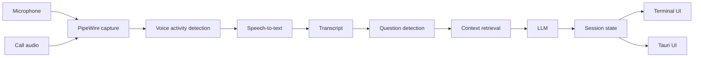

# Daemon (`dmn`)

**A Linux-native, local-first interview copilot for software engineers.**

Daemon listens to a live interview call, transcribes the conversation, detects interviewer questions, and surfaces a short answer scaffold designed to be understood in a few seconds.

The project is built for **mock interviews and interviews where AI assistance is permitted**. It does not join calls as a bot, type or speak on the user's behalf, or attempt to hide itself from screen sharing.

> **Status:** early development. The foundation CLI is working; the live TUI pipeline and desktop UI are under active development.

## Why Daemon?

Most interview assistants are browser-first, cloud-first, or built around Windows and macOS. Daemon is designed around Linux from the start:

- **Linux-native audio** via PipeWire
- **Local-first** transcription and inference
- **Wayland-first**, with X11 support planned
- **Glanceable output** instead of a scrolling chatbot
- **Low-latency target:** visible guidance within ~2 seconds of a completed question
- **Terminal-first development:** the first live UI is a `ratatui` TUI
- **Desktop UI later:** Tauri 2 over the same Rust session state
- **Provider-agnostic LLM layer:** local Ollama by default, with remote providers optional

## How it works



Daemon keeps the microphone and call audio as separate streams whenever possible, which makes speaker attribution deterministic instead of relying on diarization.

The default interaction is intentionally small:

1. Detect the current question.
2. Extract its intent and focus.
3. Generate a **3–5 line approach**.
4. Show deeper context only when requested.

No wall of text while you're trying to listen to another human.

## Current CLI

The `dmn` CLI currently includes:

```text
dmn doctor
dmn doctor --init
dmn config show
dmn devices
```

Additional commands such as `run`, `sources`, `replay`, and `bench` are planned as the live pipeline lands.

## Quick start

### Requirements

Daemon currently targets Ubuntu 24.04 / Pop!_OS 24.04-class Linux systems.

Install the build dependencies:

```bash
sudo apt install libpipewire-0.3-dev clang libclang-dev cmake just
```

You will also need:

- Rust 1.85+ (the repository includes `rust-toolchain.toml`)
- PipeWire 1.0+
- `pw-record`, `pw-play`, and `pw-dump`
- Ollama if you want local LLM inference

### Build

```bash
git clone https://github.com/njdaniel/daemon.git
cd daemon

just build
```

The release binary is written to:

```text
target/release/dmn
```

### Initialize and inspect your system

```bash
target/release/dmn doctor --init
target/release/dmn doctor
target/release/dmn devices
```

The default config lives at:

```text
~/.config/dmn/config.toml
```

## Development

The project uses `just` as its task runner.

```bash
just check     # cargo check --workspace --all-targets
just test      # cargo test --workspace
just lint      # clippy + rustfmt check
just build     # release build of dmn
just probe     # ignored tests that need a live PipeWire server
just eval      # offline evaluation harness
```

Replay fixtures are also supported by the development harness as the pipeline is implemented:

```bash
just replay sysdesign
```

## Repository layout

```text
apps/
  dmn-cli/          CLI and terminal application

crates/
  dmn-audio/        PipeWire capture and audio sources
  dmn-vad/          voice activity detection
  dmn-stt/          speech-to-text
  dmn-transcript/   transcript types and processing
  dmn-detect/       question detection
  dmn-context/      resume / job / notes retrieval
  dmn-llm/          Ollama and remote LLM providers
  dmn-session/      live session state
  dmn-store/        persistence
  dmn-core/         pipeline orchestration

docs/
  SPEC.md           product and architecture specification
  PROCESS.md        development process
  DEPENDENCIES.md   dependency decisions
  design/           UI design material
  issues/           issue specifications

eval/               offline evaluation harness
testdata/           mock-interview fixtures
```

## Design principles

### Glanceable

The default answer surface should be readable in **2–5 seconds**. Daemon prefers a handful of useful lines over a complete essay.

### Local first

Audio is intended to stay on the machine. Transcript text is only sent to a remote model when the user explicitly configures one.

### Deterministic where possible

Audio capture, segmentation, speaker attribution, and initial question detection are handled in code. The LLM is used where interpretation is actually useful.

### User remains in control

Daemon surfaces context and suggestions. The user decides what to say.

## Privacy

Daemon is being designed with privacy as a core constraint:

- audio is not written to disk by default
- local transcription is the default architecture
- Ollama is the default LLM provider
- remote providers are opt-in
- no accounts, telemetry, or cloud sync are required for v1

## Roadmap

The project is being built in stages:

- **Foundation** — configuration, diagnostics, PipeWire device discovery
- **Terminal MVP** — live capture, VAD, transcription, question detection, TUI
- **Context + quality** — resume/job context, retrieval, better detection, evaluation
- **Desktop** — Tauri 2 floating window using the same Rust session state

See [docs/SPEC.md](docs/SPEC.md) for the detailed design and build plan.

## Documentation

- [Design spec and build plan](docs/SPEC.md)
- [Development process](docs/PROCESS.md)
- [Dependency decisions](docs/DEPENDENCIES.md)
- [Claude Code project instructions](CLAUDE.md)

## License

MIT.
