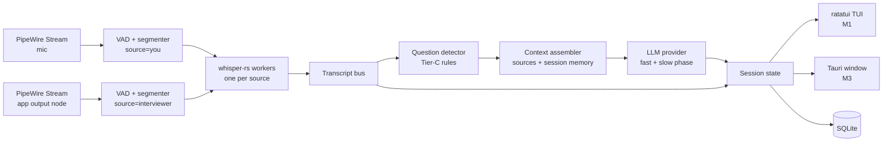

# Daemon — Design Spec & Build Plan

2026-09-21 · @Someone

## Overview

Daemon is a Linux-native floating copilot that listens to a live interview call, detects the interviewer's questions, and shows a five-line answer scaffold within about 2 seconds — never more on screen than can be read in 5 seconds.

It is for a software engineer interviewing over Google Meet, Zoom or Teams on a Linux desktop (Wayland first, X11 supported) who has prepared a resume, a job description, notes and STAR stories, and wants a quiet, local-first aid. The MVP is a terminal program (`dmn run`) that runs in a pane beside the call; the final product adds the floating window on the [Daemon canvas](https://claude.ai/artifact/Kya3g5rdSzQ7k9tGPqZV2B): 440 px wide, three areas — Live Question, AI Assistance, Transcript & status — plus Context, Settings and a collapsed pill.

**Principles**

- Glanceable: every default view fits in 2–5 seconds of reading. Nothing auto-expands; one section open at a time.
- Local-first: audio never leaves the machine. Transcript text leaves only when the user explicitly selects a remote model.
- Deterministic where possible, AI where needed: capture, segmentation, speaker attribution and question detection are code (Tier-C); interpretation and answers are the LLM (Tier-A); the user decides what to say (Tier-H).
- Latency budget: end of the interviewer's question to visible suggestion ≤ 2.0 s p50 on a mid-range laptop.
- Honest tool: helps in practice and where AI assistance is permitted. No screen-share evasion, no hidden windows, no typing or speaking on the user's behalf.

**Non-goals for v1**

- Windows or macOS builds
- Joining calls as a bot, or reading the calling app's own UI
- Auto-answering, code execution, or pasting into the interview
- Accounts, cloud sync, telemetry

## Decisions

Rust is the language: one binary, one process, native PipeWire and whisper.cpp bindings, no GC and no subprocesses on the audio path. Python is used only for the offline eval harness. Rust costs more agent turns per issue than Go would; the handoff section budgets for that.

| Area | Choice | Why | Also considered |
| --- | --- | --- | --- |
| Language | Rust, stable toolchain, edition 2024; Cargo workspace | Lowest end-to-end latency: audio callbacks, VAD and whisper all in-process on dedicated threads; first-party PipeWire binding; single static-ish binary | Go (faster to write, but no maintained PipeWire binding and a beta webview shell); Python (eval scripts only) |
| UI shell | M1–M2: terminal TUI with `ratatui` + `crossterm` (`dmn run`). M3+: Tauri 2 (stable) on wry/WebKitGTK 4.1, GTK3, as a second surface over the same `Session` state | The TUI ships the pipeline weeks earlier, runs in tmux beside the call, and proves the 2–5 s readability rule with zero GUI dependencies; the web front end then ports the canvas design 1:1 with Tauri commands + events | iced or egui (pure Rust, no WebKitGTK dependency, lowest render latency, but the Linear-style design would be hand-built); gtk4-rs + libadwaita (native, wrong aesthetic) |
| Front end | M3: Vite + TypeScript, no framework; `@tauri-apps/api` invoke + listen | Three views and one state object; a framework costs more than it saves | Svelte or Solid if state grows |
| Audio | [`pipewire` crate](https://docs.rs/crate/pipewire/latest) (official pipewire-rs) 0.10: main loop on its own thread, one capture `Stream` per source, registry listener for discovery, `target.object` to capture one app's output node | Native, per-app capture, hot-plug events, 10 ms quantum; no PCM over pipes | `pw-record` subprocess (kept only as the `dmn doctor` sanity check and emergency fallback); cpal (no per-app targeting); PulseAudio shim |
| STT | `whisper-rs` (whisper.cpp via cmake; features `vulkan`, `cuda`, `openblas`); `ggml-small.en` default, `base.en` on weak CPUs, `large-v3-turbo` with GPU | Same engine as before, first-class Rust API, GPU backends by feature flag | `whisper-server` sidecar (chunk-per-request loses context); faster-whisper sidecar (Python; kept as an optional `stt.engine` if GPU throughput matters) |
| VAD | M1: energy + silence-gap VAD in Rust. M2: Silero via `ort` (ONNX Runtime) | Enough to segment utterances for the first model | Silero from day 1 (adds ORT to M1) |
| Async & threads | tokio for HTTP, SQLite access and UI events; `std::thread` for the PipeWire loop and each whisper worker; `ringbuf` SPSC ring buffers from capture to VAD; `tokio::sync::broadcast` for session state | Real-time capture never touches the async runtime | async-std; a single-threaded design |
| LLM | `Provider` trait (async, streaming) with three implementations: Ollama (`/api/chat`, NDJSON stream, JSON-schema `format`), OpenAI-compatible (`/v1/chat/completions`, SSE), Anthropic Messages API. Default: Ollama, model from config (`qwen3.6:35b-a3b`, chosen 2026-09-21 by measurement over `llama3.1:8b` and `qwen3.6:27b`). `reqwest` + `serde` | Local by default; remote is one config change; structured output keeps the UI deterministic | Framework crates (wrong layer) |
| Storage | `rusqlite` (`bundled`) with a small migration runner; `serde_json` for exports | Session memory needs queries; bundled SQLite avoids distro version drift | sqlx (async, but overkill); JSONL only |
| Config & CLI | TOML via `serde` + `toml` at `~/.config/dmn/config.toml` (`directories` crate); binary `dmn` via `clap` with `run`, `doctor`, `devices`, `sources add`, `replay`, `bench` | Fits terminal-first use; `doctor`, `replay` and `bench` make Claude Code's work testable without a live call | GUI-only settings |
| Packaging | M1: `cargo tauri build` (AppImage + deb from Tauri's bundler). M3: Flatpak (needs the PipeWire socket permission) | AppImage carries WebKitGTK cleanly | Snap (no) |
| Always-on-top | X11/XWayland: `set_always_on_top` (GTK keep-above). Wayland: no xdg-shell API; try compositor support (Hyprland, sway, KDE), else a setting that launches under XWayland (`GDK_BACKEND=x11`) | Wayland-first without lying about what compositors allow | wlr-layer-shell via `gtk-layer-shell` (not on GNOME; M3 option for tiling WMs) |

## Architecture

One Rust process, one thread per real-time stage, a tokio runtime for everything that talks to the network or the window, and a single `Session` state struct that the UI mirrors over Tauri events. Every stage can be fed from a WAV file instead of PipeWire, so the whole pipeline runs headless in tests and in `dmn replay`.



Audio enters as two labelled streams, so speaker attribution is a property of the source, not an inference. The detector only proposes; the LLM's fast phase confirms and extracts the question; the UI shows the fast phase within the latency budget and fills expandable sections from the slow phase afterwards.

**Repo layout** (`daemon` repo, one Cargo workspace, binary `dmn`)

| Path | Holds |
| --- | --- |
| `crates/dmn-audio/` | `AudioSource` trait; `PipeWireSource` (registry discovery, capture streams, hot-plug), `WavSource`; ring buffers, resampler |
| `crates/dmn-vad/` | Energy/silence VAD (M1), Silero via `ort` (M2); emits `Utterance { source, start, end, samples }` |
| `crates/dmn-stt/` | `whisper-rs` wrapper, per-source worker thread, sliding-window partials, hallucination filter |
| `crates/dmn-transcript/` | `Segment` types, bus, punctuation/merge rules |
| `crates/dmn-detect/` | Question detector: cue rules, scoring, pin logic |
| `crates/dmn-context/` | Source ingestion (PDF via `pdf-extract`, MD, TXT), chunking, BM25 retrieval, session summariser |
| `crates/dmn-llm/` | `Provider` trait; `ollama`, `openai`, `anthropic` modules; prompt templates; JSON schema + `limits.rs` |
| `crates/dmn-session/` | `Session` state, reducers, `broadcast` fan-out |
| `crates/dmn-store/` | `rusqlite` schema + migrations |
| `crates/dmn-core/` | Wires the pipeline; the only crate that knows every stage; used by both binaries |
| `apps/dmn-cli/` | The `dmn` binary: `run` (TUI, `--replay`, later `--gui`), `doctor`, `devices`, `sources`, `config`, `replay`, `bench`; `tui/` module with one widget per area |
| `apps/dmn-desktop/` | M3: Tauri 2 app (`src-tauri/`): window options, commands, event bridge |
| `frontend/` | M3: Vite + TS; `src/views/{live,context,settings,collapsed}`; `src/tokens.css` |
| `eval/` | Python harness: fixture WAVs, scripted question lists, precision/recall + latency report |
| `testdata/` | Mock-interview WAVs and expected transcripts |

**Threading rules**

- The PipeWire main loop owns one OS thread; its process callback only copies samples into a lock-free `ringbuf` producer and returns. No allocation, no logging, no locks in the callback.
- VAD runs on its own thread per source, draining the ring buffer in 20 ms frames; a full buffer drops the incoming 20 ms frame (the lock-free producer never touches the consumer's read index) and increments a counter the status bar reads.
- One `whisper-rs` `WhisperState` per source on a dedicated worker thread; inference is serialised per state. Workers receive `Utterance`s over a bounded `crossbeam` channel and publish `Segment`s to the transcript bus.
- The detector, context assembler and LLM stage run as tokio tasks. The LLM task holds a `CancellationToken` per request and cancels the in-flight one when a newer unpinned question arrives.
- `Session` lives behind a `tokio::sync::watch`; the Tauri bridge coalesces emits to at most 30 per second; transcript text arrives as deltas, suggestions as whole objects.
- No `unwrap`/`expect` in pipeline crates; errors are `thiserror` enums and reach the UI as status-dot states.

## Audio capture on PipeWire

Two capture streams run for the whole session: the microphone (labelled **You**) and the calling app's playback stream (labelled **Interviewer**). Because they arrive on separate pipes, speaker separation is free in the common case; diarization is only a fallback.

**Discovery** — `dmn devices` and the Settings picker both use a registry listener on the PipeWire thread (the `pipewire` crate's `Registry::add_listener`) and keep a live node table:

- Capture sources: nodes with `media.class = Audio/Source` (mic) and their `node.description`.
- App streams: nodes with `media.class = Stream/Output/Audio`, shown as `application.name` + `media.name` (for example "Firefox — Google Meet", "zoom", "teams-for-linux"). Global-added and global-removed events update the table instantly; no polling. `pw-dump` is used only by `dmn doctor` to cross-check the table.

**Capture (M1)** — one `pipewire::stream::Stream` per source, connected as `Direction::Input`, requesting `F32LE`, 16 kHz, mono (PipeWire resamples and downmixes for us), with `Stream::connect` flags `AUTOCONNECT | MAP_BUFFERS | RT_PROCESS`. Properties:

```
media.type=Audio  media.category=Capture  media.role=Communication
node.name=dmn.<source>  node.latency=160/16000   # 10 ms quantum
target.object=<node.id or node.name of the chosen source or app stream>
stream.capture.sink=true                                   # only for the sink-monitor fallback
```

- Mic: `target.object` = the chosen `Audio/Source` node (default: PipeWire's default source, resolved from the metadata object).
- Interviewer: `target.object` = the chosen app's `Stream/Output/Audio` node, so only that app's audio is captured, not the user's own music or notifications. Fallback when no app stream is selected or found: the default sink with `stream.capture.sink=true`, and a visible "capturing all system audio" badge.
- If the app stream disappears (call ends, app restarts), the registry's global-removed event marks the interviewer source `disconnected`; the mic keeps running; when a stream with the same `application.name` reappears, a new capture stream is connected automatically.

**Speaker attribution**

1. By source (default): mic → You, loopback → Interviewer.
2. Echo guard: when both sources are active in the same 300 ms and the mic segment's text is a near-duplicate of the loopback segment (ratio ≥ 0.8), drop the mic copy. This handles laptops without echo cancellation.
3. Single-stream fallback (system audio off, or an in-person interview): all audio is "Unknown" until diarization lands (M3/M4; in-person interviews are out of scope for v1, decided 2026-09-25); question detection still runs on all text.

**Verify at M0** (`dmn doctor` checks these and prints a fix for each): `libpipewire-0.3` headers and library present; PipeWire server running and its version; a capture stream with `target.object` set to a `Stream/Output/Audio` node actually receives that app's audio on the user's PipeWire version (`doctor --probe` plays a tone through `pw-play` and captures it back); `pw-record` on PATH for the emergency fallback; mic permission under Flatpak later.

**Latency budget for this stage**: 10 ms PipeWire quantum, 20 ms VAD frames, VAD decision on 300 ms of trailing silence for a pause and 500 ms for utterance end (`[stt].vad_close_ms`; 700 ms until #16's tuning missed the 2.0 s p50 live), so an utterance reaches STT within about 0.55 s of the speaker stopping.

## Transcription and question detection

STT runs per utterance, not per fixed chunk: the VAD closes an utterance after 500 ms of silence (or at 12 s, whichever comes first) and whisper transcribes it whole, with the previous utterance's text passed as prompt for continuity. Partial results every 1 s keep the transcript strip moving while a long utterance is still open.

**STT worker**

- Input: 16 kHz mono f32; `whisper-rs` `FullParams` with `SamplingStrategy::Greedy`, `language=Some("en")`, `no_context=true`, `single_segment=true`, `temperature=0`, `suppress_blank=true`, `n_threads` from config. The previous final goes in explicitly as prompt tokens; `no_context=true` stops whisper.cpp also prepending its own last decode, which is usually a partial of the same utterance and made the final drop the words that partial covered (#39).
- Sliding window for partials: the last 8 s of the open utterance, re-run every 1 s; the final pass replaces all partials for that utterance.
- Output: `Segment { source, start, end, text, is_final, avg_logprob }`. Segments with `avg_logprob < -1.0`, or fewer than 3 words that match whisper's known hallucination phrases ("Thank you.", "Thanks for watching."), are dropped.
- Model files live in `~/.cache/dmn/models/`; `dmn doctor --fetch small.en` downloads. Default `small.en`; `dmn bench` measures real-time factor on the target machine at M0 and records it in `doctor` output. GPU: build with `--features vulkan` (or `cuda`) and the same code path applies.

**Question detector (Tier-C, runs on every final Interviewer segment)**

Score = sum of matched cues; a segment becomes a candidate at score ≥ 2:

| Cue | Points |
| --- | --- |
| Ends with `?` from whisper punctuation | 2 |
| Starts with a wh-word or aux verb (how, what, why, when, which, can, could, would, tell me, walk me through, describe, explain, imagine, suppose) | 2 |
| Contains a hand-off phrase ("let's switch gears", "next question", "I'd like to hear", "talk me through") | 1 |
| Source is Interviewer | 1 |
| Longer than 6 words | 1 |
| Interviewer segment followed by ≥ 1.5 s of silence or a You segment | 1 |
| Ends with "...right?" or "you know?" (rhetorical) | −2 |
| Mostly small talk vocabulary (weather, weekend, coffee, can you hear me) | −2 |

**Extraction (Tier-A, the LLM fast phase)** receives the last 60 s of transcript with speaker labels and the candidate, and returns `{is_question, question, kind, focus}` where `kind` is one of `system_design | coding | behavioral | knowledge | clarification | small_talk`. Rules:

- `is_question=false` or `kind=small_talk` → nothing changes on screen; the candidate is logged with its score for the eval harness.
- Multi-part questions ("how would you design X, and how would you test it?") are kept as one question with both parts; the Approach covers both.
- A follow-up that only refines the current question ("and what if Redis goes down?") gets `kind=clarification` and is shown as a sub-line under the current question instead of replacing it.
- Pinned: a new question never replaces a pinned one; it is queued and shown as a small "1 new" badge on the Live Question header.

**Targets** (measured by the eval harness on scripted mock interviews): question recall ≥ 0.85, precision ≥ 0.8 at M1; recall ≥ 0.9, precision ≥ 0.9 at M2. Detection latency from end of utterance to candidate ≤ 100 ms; STT dominates.

## Context and LLM

Every suggestion is one structured JSON object produced in two phases: a fast phase that fills the Live Question and the five-line Approach, and a slow phase that fills the expandable sections. The UI never renders free text from the model; it renders fields.

**Sources** (`dmn sources add <path>` or the Context view)

- Accepted: PDF, Markdown, plain text. Resume and job description are single documents; notes and stories are folders, one file per story.
- Ingestion: text extraction → chunks of about 300 tokens with 50 overlap → stored in SQLite with source, path, chunk index. Stories additionally get a tag line (`tags: conflict, ownership`) parsed from front matter or the first line.
- Retrieval per question: BM25 over chunks (pure Rust, no vector DB in v1) with the question + focus as query; top 6 chunks, capped at 1,500 tokens. Stories are matched by tag overlap with the question `kind=behavioral` themes first, BM25 second.
- Job description is always summarised once at load into ≤ 8 requirement bullets and included in every prompt (cheap, high value).

**Session memory**

- Rolling summary: after every answered question, the slow phase appends one line ("14:31 rate limiter — covered token bucket, Redis, fail-open; promised to return to clock skew").
- The prompt carries the last 8 summary lines plus the last 60 s of raw transcript, not the whole transcript.
- "Promised to return to" items surface in Things I Should Mention on later questions until mentioned.

**Prompt contract**

System prompt (fixed per `kind`): role, the five-line rule, the JSON schema, the "no paragraphs" rule. User message: job requirements, retrieved chunks, session summary, recent transcript, the extracted question. Both phases request JSON; Ollama gets the schema in `format`, OpenAI-compatible gets `response_format`, Anthropic gets a tool with the schema.

```json
{
  "question": "How would you design a rate limiter for a globally distributed API?",
  "kind": "system_design",
  "focus": "architecture, consistency tradeoffs, Redis/distributed state, failure handling",
  "approach": ["Clarify requirements and rate-limit scope.", "...", "...", "...", "..."],
  "deeper": [{"label": "Algorithm", "text": "..."}],
  "followups": ["..."],
  "tradeoffs": [{"option": "Centralized Redis", "pro": "exact", "con": "one hop, SPOF"}],
  "example": {"language": "text", "code": "..."},
  "mention": ["..."],
  "resume_context": [{"source": "resume.pdf", "text": "..."}],
  "star": {"situation": "...", "task": "...", "action": "...", "result": "...", "story": "stories/x.md"}
}
```

Fast phase returns `question`, `kind`, `focus`, `approach` (and `star` for behavioral); slow phase returns the rest. Field limits are enforced in Rust after parsing: approach 3–5 items of ≤ 90 characters, `focus` ≤ 120 characters, every list ≤ 5 items, `deeper` ≤ 4 entries of ≤ 240 characters. Anything over is truncated at a sentence boundary and flagged in the debug log, never shown as a wall.

**Providers**

| Provider | Endpoint | Streaming | Structured output | Notes |
| --- | --- | --- | --- | --- |
| Ollama (default) | `http://localhost:11434/api/chat` | yes | `format` = JSON schema | `keep_alive` set so the model stays loaded for the session; warm-up request at start |
| OpenAI-compatible | `<base_url>/v1/chat/completions` | yes | `response_format` json\_schema | Covers OpenRouter, vLLM, LM Studio, OpenAI; API key from config or env |
| Anthropic | `https://api.anthropic.com/v1/messages` | yes | tool use with the schema | API key from env |

Timeouts: fast phase 4 s, slow phase 20 s; on timeout the UI keeps the previous section content and shows a small "slow" tag. A remote provider is used only when `[llm].provider` is not `ollama`, and Settings states in words that transcript text leaves the machine.

## UI spec

The window is 440 px wide, 760 px tall by default, frameless with a 36 px custom title bar, always-on-top where the compositor allows, and it never grows on its own. The [canvas](https://claude.ai/artifact/Kya3g5rdSzQ7k9tGPqZV2B) is the visual source of truth; this section states the behavior.

**Terminal MVP (M1–M2)** renders the same three areas in a ratatui TUI, sized for a 100 × 30 pane beside the call: question + focus in a top block (2–4 lines), the numbered Approach in the middle, the last two transcript lines and the mic / system / model status in a one-line footer. Keys: `p` pin, `r` regenerate, `1`–`6` toggle one section, `m` mute mic, `s` coding solutions hints ↔ full, `w` swap the STAR story (#58), `q` quit. The same density rules apply: no paragraph over 3 sentences, one section open at a time, nothing auto-expands. Everything below describes the M3 window.

**Window**

- Min size 380 × 520; the AI Assistance area is the only scrolling region.
- Remembers position and size per monitor layout in config.
- Collapsed pill (⌥H): 440 × 92, shows the current question in one line and which Approach point the user is on ("3/5") based on the last You segment matched against approach items.
- Opacity setting 70–100 %, default 100 %.
- Wayland: GTK window with `xdg-toplevel`; X11: `keep_above` + `skip_taskbar`.

**1. Live Question**

- Label states: `LIVE QUESTION` (teal dot) / `PINNED QUESTION` (amber) / `LISTENING` (no question yet, shows the last interviewer sentence in muted text).
- Question text: 17 px, at most 3 lines; longer questions are ellipsised with the full text on hover and in the transcript.
- Focus line: ≤ 120 characters, hidden when the model returns none.
- Pin: click or ⌥Space; while pinned, new questions queue and a "1 new" badge appears; unpin shows the newest.
- Clarification follow-ups render as a second 13 px line under the question with a ↳ glyph.

**2. AI Assistance**

- Approach: 3–5 numbered lines, each ≤ 90 characters, visible within 2.0 s of the question ending. While loading, the previous Approach dims to 50 % rather than clearing.
- Six expandable rows in fixed order: Deeper Answer, Follow-up Questions, Tradeoffs, Example, Things I Should Mention, Resume Context. Shortcuts ⌥1–⌥6. Exactly one open at a time; opening another closes the first. Rows whose slow-phase content is not yet available show a subtle "…" hint; rows with no content for this question are hidden.
- Behavioral questions replace the Approach block with the STAR block (S/T/A/R cards, Action card emphasised, matched story path in the header, Swap picks another story).
- Coding questions show Approach + Example (language from the job description or config). What Deeper Answer holds follows the coding-solutions mode (#50): **hints** (the default) gives the key insight, the data structure, edge cases and pitfalls, and time/space complexity, with no complete code; **full** adds a worked solution in the job's language, capped in `limits.rs` (≈ 40 lines). Either way it stays collapsed until opened. The mode comes from `[ui].coding_solutions`, `dmn run --solutions <hints|full>` overrides it for one run, and `s` toggles it during a call; the footer shows `s: hints` / `s: full` while a coding question is on screen, and each stored question records the mode it was detected under.
- Redo regenerates with `temperature=0.7` and the note "user asked for a different angle".

**3. Transcript & status**

- Last two segments, one line each, speaker label in mono; the open utterance shows partial text with a trailing cursor.
- Status dots: mic, system audio (with app name), model. Red dot + tooltip on failure; the dots are the only place errors appear during a call.
- Footer shows the two most useful shortcuts for the current state.

**Keyboard**

| Shortcut | Action |
| --- | --- |
| ⌥Space | Pin / unpin |
| ⌥1 … ⌥6 | Toggle section 1–6 |
| ⌥H | Collapse to pill / expand |
| ⌥R | Regenerate |
| ⌥M | Mute mic capture (still transcribes interviewer) |
| ⌥, | Settings |
| ⌥C | Context |

Shortcuts are registered inside the window (WebKit key events), not globally; a global hotkey for ⌥H is an M3 item because it is compositor-specific on Wayland.

**Density rules** (enforced in the front end, not left to the model)

- No paragraph longer than 3 sentences anywhere in the live view.
- No section content taller than the window: overflow scrolls inside the section.
- Type scale: 17 / 13.5 / 12.5 / 11 / 10.5 px; mono for labels, timestamps, shortcuts and code only.
- Colors: graphite ground `#121417`, panel `#15181c`, border `#22262d`, text `#e8eaed`, muted `#9aa3ad`, accent teal `#5fd3a6`, pinned amber `#e8b04f`. Contrast ≥ 4.5:1 for all text.
- No toasts, no modals, no animations longer than 150 ms during a call.

## Data, config and privacy

Everything lives under XDG paths, audio is never written to disk unless the user turns on session recording, and the only network calls are to the configured LLM endpoint and to model downloads the user starts.

| Path | Contents |
| --- | --- |
| `~/.config/dmn/config.toml` | All settings; created by `dmn doctor --init` with comments |
| `~/.local/share/dmn/sources/` | Copies of ingested resume, JD, notes, stories (originals untouched) |
| `~/.local/share/dmn/dmn.sqlite` | Sessions, segments, questions, suggestions, chunks, summaries |
| `~/.local/share/dmn/sessions/<id>.jsonl` | Optional export of a session's transcript + suggestions |
| `~/.cache/dmn/models/` | whisper ggml files |
| `~/.local/state/dmn/dmn.log` | Structured log (tracing, JSON), rotated at 10 MB |

```toml
[audio]
mic = "default"                      # pw node.name or "default"
system_audio = true
app_stream = "Firefox"               # application.name match; "" = sink monitor
echo_guard = true

[stt]
engine = "whisper.cpp"
model = "small.en"
threads = 8                          # per lane; 4 missed the 2 s p50 (#15)
vad = "energy"                       # energy | silero (M2)
vad_close_ms = 500                   # silence that ends an utterance; shorter = faster, more splits

[detect]
sensitivity = "balanced"             # eager | balanced | strict

[llm]
provider = "ollama"                  # ollama | openai | anthropic
model = "qwen3.6:35b-a3b"           # measured 2026-09-21 on the dev 4090; see CLAUDE.md
base_url = "http://localhost:11434"
api_key_env = ""                     # name of an env var; never the key itself
answer_length = "concise"            # concise (5) | minimal (3)
fast_timeout_ms = 4000
slow_timeout_ms = 20000              # 0 turns the slow phase off

[ui]
always_on_top = true
force_x11 = false                    # launch under XWayland for keep-above
opacity = 1.0
never_auto_expand = true
coding_solutions = "hints"           # hints | full (worked solutions in Deeper Answer)

[privacy]
record_audio = false                 # write WAVs of the session
keep_transcripts = true
```

**Privacy rules**

- Audio buffers are in memory only; `record_audio=true` writes WAVs under `sessions/` and shows a red REC dot.
- With `provider=ollama` nothing leaves the machine. With any other provider, the exact payload (transcript window, retrieved chunks, summary) is what leaves; Settings says so in one sentence and `dmn doctor` prints the provider in use.
- API keys are read from the named environment variable at start and never written to config, logs or the database.
- `dmn sessions purge <id|all>` deletes rows and files; there is no cloud copy to purge.
- No telemetry, no update checks; `dmn version` compares against GitHub releases only when asked.

## Milestones

The MVP is M1: a terminal program (`dmn run`, a small ratatui TUI) that takes a live call in and puts a five-line Approach out, within budget, on real PipeWire audio. The desktop window from the canvas is M3. Every milestone ships a usable tool; the pipeline crates never change shape between the terminal and the window, only the surface does.

| Milestone | Surface | Scope | Done when |
| --- | --- | --- | --- |
| M0 — Scaffold | CLI | Cargo workspace, config loader, `dmn doctor` (libpipewire, PipeWire server + probe, whisper model, Ollama reachability, GPU backend), `dmn devices`, `dmn bench`, fixtures in `testdata/`, CI running `cargo test` on Ubuntu 24.04 | `dmn doctor` passes on the dev machine; CI green |
| M1 — MVP | Terminal TUI | Mic + app-stream capture via `pipewire` streams, energy VAD, `whisper-rs` workers, rule detector, LLM fast phase (Ollama), SQLite session log, `dmn replay <wav> <wav>`; `dmn run` draws the three areas in the terminal: question + focus (top), Approach (middle), last two transcript lines + status (bottom); keys: `p` pin, `r` regenerate, `q` quit | On the 3 fixture interviews: recall ≥ 0.85, precision ≥ 0.8, p50 question-end → Approach ≤ 2.0 s, p95 ≤ 3.5 s with `small.en`; 60-minute live Meet call in a terminal beside the call without crash or ring-buffer overrun; CPU average ≤ 1 core while idle-listening |
| M2 — Context | Terminal TUI | Slow phase + six expandable sections (keys `1`–`6`, one open at a time), sources ingestion (PDF/MD/TXT), BM25 retrieval, session memory summariser, STAR mode with story matching, OpenAI-compatible + Anthropic providers, Silero VAD via `ort`, echo guard; `dmn sources` and `dmn config` subcommands stand in for the Context and Settings views | All six sections fill within 20 s; a behavioral fixture question yields a STAR block with a matched story; provider switch via config reload without restart; recall ≥ 0.9, precision ≥ 0.9 |
| M3 — Desktop window | Tauri 2 | The canvas design: floating 440 px window with Live Question, AI Assistance, Transcript & status; Context and Settings views; collapsed pill; keyboard map from the UI spec; X11 keep-above; `dmn run --gui` and a `.desktop` entry. The TUI stays as `dmn run --tui` | Window matches the canvas; every M2 feature reachable in the window; same eval numbers as M2 |
| M4 — Polish and ship | Both | Always-on-top per compositor + `force_x11` + optional `gtk-layer-shell`, app-stream hot re-attach, diarization fallback, global ⌥H hotkey where possible, opacity, AppImage + deb, Flatpak manifest, eval report in CI, README with a 5-minute setup | AppImage runs on a clean Ubuntu 24.04 and Fedora 42 VM; eval report published per commit |

**Fixtures for M1** (created in M0, checked into `testdata/`, generated with two TTS voices so they can be redistributed): three 10-minute mock interviews — system design, behavioral, mixed with small talk — each as two WAVs (interviewer, candidate) plus a `questions.json` listing every real question with its timestamp. `dmn replay` feeds both WAVs through the real pipeline at 1× or faster and writes the same session log a live call would.

**Order inside M1** (each step leaves `main` working)

1. `dmn-audio`: `WavSource` + `PipeWireSource` behind `AudioSource`; `dmn devices` lists nodes from the registry.
2. `dmn-vad` + `dmn-stt`: `dmn replay` prints timestamped, labelled segments to stdout.
3. `dmn-detect`: replay prints candidates with scores; eval script reports recall/precision.
4. `dmn-llm` Ollama fast phase; replay prints question + approach JSON.
5. `dmn-session` + the ratatui TUI: `dmn run` updates live; pin, regenerate and quit work; `dmn run --replay` drives the TUI from fixtures at 1× for demos.
6. Live run against a real Meet call; tune VAD thresholds and detector weights from the log.

## Claude Code handoff

Hand off four things, in this order: the repo skeleton, `docs/SPEC.md` (this doc), the fixtures, and the issues. An issue is the unit of work: one issue = one headless `claude -p` run (or one interactive session) that leaves `main` green. The earlier 10-issue list is split into 16 below so that no issue introduces more than one new crate or one unfamiliar API at a time; that is the granularity a Rust agent needs.

**What Claude Code receives**

1. A repo with the workspace scaffold, `docs/SPEC.md`, `docs/design/` (the canvas HTML), `CLAUDE.md`, `justfile`, `rust-toolchain.toml` and CI — the bootstrap checklist below.
2. `testdata/` fixtures — the one input only a human can produce.
3. Issues #1–#16 from the table below, each filled with the issue template, labelled `m0` or `m1`, with `Depends on` set as listed.
4. The kickoff prompt below for the first run; every later run gets "Implement issue #N" plus the issue body.

**Repo bootstrap (human, 15 minutes)**

- [ ] Create the `daemon` repo; `cargo new --lib` each crate listed in Architecture and `cargo new --bin apps/dmn-cli`; commit the canvas HTML as `docs/design/` for M3
- [ ] Add `docs/SPEC.md` (this doc, exported), `CLAUDE.md`, `justfile`, `rust-toolchain.toml`, `.github/workflows/ci.yml`
- [ ] Install system deps once and record the exact package list in `CLAUDE.md`: `libpipewire-0.3-dev`, `cmake`, `clang`, plus `libvulkan-dev` or CUDA if GPU inference is wanted (`libwebkit2gtk-4.1-dev` and `libgtk-3-dev` only at M3)
- [ ] Record or generate the three fixture interviews (`testdata/`), because Claude Code cannot make audio
- [ ] Open issues #1–#16 with labels `m0`, `m1`

**CLAUDE.md** (keep under 80 lines)

```markdown
# Daemon (`dmn`)
Rust Linux interview copilot. M1–M2 is a ratatui TUI; M3 adds a Tauri 2 window. Spec: docs/SPEC.md. Design: docs/design/.

## Commands (use `just`; every recipe is also runnable by hand)
- Check fast: `just check` (`cargo check --workspace --all-targets`) — run this after every edit
- Test: `just test` (`cargo test --workspace`)
- Lint: `just lint` (`cargo clippy --workspace --all-targets -- -D warnings`, `cargo fmt --check`)
- Build: `just build` (`cargo build --release -p dmn-cli`; M3 adds `cargo tauri build`)
- Replay a fixture: `cargo run -p dmn-cli -- replay testdata/sysdesign/interviewer.wav testdata/sysdesign/candidate.wav`
- Eval: `just eval` (python eval/run.py; prints recall/precision/latency)

## Rules
- The PipeWire process callback allocates nothing, locks nothing, logs nothing.
- No `unwrap`/`expect` outside tests and `main`; errors are `thiserror` enums per crate.
- Never write audio to disk unless `privacy.record_audio` is true.
- The UI renders JSON fields only; enforce length limits in `crates/dmn-llm/src/limits.rs`, not in prompts.
- No new dependencies without a line in docs/DEPENDENCIES.md saying why; no `unsafe` outside `dmn-audio` and `dmn-stt`, and every `unsafe` block has a `// SAFETY:` comment.
- Every crate's `lib.rs` doc comment states its input, output and the channel it owns.
- Tests use testdata WAVs, never a microphone; CI has no PipeWire. Anything that needs PipeWire is behind `#[ignore]` and run by `just probe` on a dev machine.
- Keep the TUI's three-area layout (question / approach / transcript+status); the M3 window follows docs/design/.

## Done means
- `just check`, `just test` and `just lint` pass; the issue's acceptance criteria are met and stated in the PR body.
```

**Issues, in order** (acceptance criteria in each issue body come from the Milestones table)

| # | Title | Milestone | Depends on |
| --- | --- | --- | --- |
| 1 | Workspace scaffold: every crate as an empty lib with its `lib.rs` doc comment, `dmn --version`, `justfile`, CI green | M0 | — |
| 2 | Config: TOML loader, XDG paths, `dmn doctor --init`, `tracing` JSON log | M0 | 1 |
| 3 | `dmn-audio` part 1: `AudioSource` trait, `WavSource`, `ringbuf` plumbing, resampler; unit tests on fixtures | M0 | 2 |
| 4 | `dmn-audio` part 2: PipeWire main-loop thread, registry listener, live node table, `dmn devices` | M0 | 3 |
| 5 | `dmn-audio` part 3: `PipeWireSource` capture stream with `target.object`, sink-monitor fallback, `dmn doctor --probe` | M0 | 4 |
| 6 | `dmn doctor` full checks (libpipewire, model file, Ollama reachability, GPU backend) + CI: system deps, cached whisper.cpp build | M0 | 2 |
| 7 | `dmn-vad`: energy VAD + utterance segmenter, tests on fixtures | M1 | 3 |
| 8 | `dmn-stt` part 1: `whisper-rs` wrapper, model lookup/download, `dmn bench` real-time factor | M1 | 6, 7 |
| 9 | `dmn-stt` part 2: per-source worker thread, partials, hallucination filter; `dmn replay` prints labelled segments | M1 | 8 |
| 10 | `dmn-detect`: rule scorer; `eval/run.py` recall/precision on fixtures | M1 | 9 |
| 11 | `dmn-llm` part 1: `Provider` trait, Ollama client (NDJSON streaming, JSON-schema `format`), `MockProvider` for tests | M1 | 2 |
| 12 | `dmn-llm` part 2: fast-phase prompt + schema + `limits.rs`; replay prints question + approach JSON | M1 | 10, 11 |
| 13 | `dmn-session` + `dmn-store`: state reducers, `watch`/broadcast, SQLite schema + migrations; replay writes a session log | M1 | 12 |
| 14 | TUI part 1: static ratatui layout rendered from a saved `Session` JSON fixture; snapshot tests | M1 | 13 |
| 15 | TUI part 2: live wiring, keys `p r m q`, status line, `dmn run --replay` | M1 | 14 |
| 16 | Live-call tuning: VAD thresholds, detector weights, `dmn bench --live` latency report | M1 | 15 |

Two lanes run in parallel: audio (#3–#5, then #7–#10) and LLM (#11) share only #2, so a second agent can take #11 while the first is in the PipeWire code. Issues #5 and #9 are the two that touch unfamiliar C-backed APIs; expect two runs each.

**Issue template** (paste into each)

```markdown
## Goal
One sentence from the spec section.
## Scope
Crates/files touched. Out of scope: everything else, including later issues.
## Acceptance
- [ ] criterion copied from docs/SPEC.md Milestones
- [ ] `just check`, `just test` and `just lint` green
## Verify
Exact command(s) and expected output.
```

**Kickoff prompt** (first run, issue #1; later runs change the issue number)

```
Read CLAUDE.md and docs/SPEC.md in full before writing code. Implement issue #1 exactly as scoped; do not start later issues or refactor beyond it. Run `just check` after every edit, and `just test` + `just lint` before you finish. Open a PR whose body lists each acceptance criterion with the command you ran to verify it. If the spec and the issue disagree, the issue wins; say so in the PR.
```

**Headless-run notes**

- Allowed tools per run: file edit, `just check`, `just test`, `just lint`, `cargo run -p dmn-cli -- replay ...`; no network except crates.io.
- Budget: about 30 turns per issue at this granularity; #5 and #9 get two runs. Rust compile-test loops are the cost driver, so `just check` (seconds) between edits and `just test` only when check is clean.
- If a run stalls, split along the issue's own bullet list rather than merging a half-done PR.
- Human review points: after #5 (does per-app capture work on your PipeWire?), after #10 (are detector weights sane on the fixtures?), after #14 (does the TUI read in 2–5 s?), after #16 (first live call). M2 and M3 issues are opened after #16 lands, from the Milestones table.

## Open questions and risks

The two decisions most likely to change are the `pipewire` crate's low-level API for per-app capture and the whisper.cpp build inside `whisper-rs`; both have a cheap fallback and are checked in M0 before anything depends on them.

| Risk | Likelihood | Fallback |
| --- | --- | --- |
| `pipewire` crate stream/param code (SPA pods) is verbose and easy to get wrong for an agent | Medium | `doctor --probe` catches it in M0; emergency `pw-record` subprocess source behind the same `AudioSource` trait |
| `target.object` on a `Stream/Output/Audio` node does not capture that app on the installed PipeWire | Low–medium | Default sink monitor + echo guard; per-app capture via explicit `pw-link` of ports in M3 |
| `whisper-rs` cmake build fails on the distro (or GPU feature flags) | Medium | Pin whisper.cpp commit; CPU-only build first; `whisper-server` sidecar behind `stt.engine` |
| whisper `small.en` too slow on the target laptop for the 2.0 s budget | Medium on CPU-only | `base.en`, or `--features vulkan`; measured in M0 by `dmn bench` |
| Tauri's WebKitGTK 4.1 version on the distro renders the design differently | Low | Design uses only widely supported CSS; CI screenshot check in M3 |
| Local 8B model produces weak or off-schema Approach lines | Medium | Schema-constrained decoding via `format`; Rust-side limits; remote provider one config line away |
| Always-on-top silently ignored on GNOME Wayland | High on GNOME | `force_x11=true` launches under XWayland; `gtk-layer-shell` for wlroots/KDE in M3; documented per compositor |
| Whisper hallucinations on silence create fake questions | Medium | Hallucination phrase filter + VAD gate + detector score; tracked as false positives in eval |
| Echo (no AEC) makes the user's voice appear as Interviewer | Medium on laptops | Echo guard (text near-duplicate within 300 ms); recommend headphones in README |
| Agent turn budget: Rust issues take longer than the Go plan would have | High | Budgeted in the handoff; `just check` loop; split issues by pipeline step |

**Open questions**

- [ ] Target hardware for the latency numbers: which laptop, CPU-only or GPU (Vulkan/CUDA)? Sets the default model. Partly answered: M1 was measured on the dev box's CPU (Ryzen 7700X, `small.en`, 8 threads: fixture p50 1.78–1.85 s), and GPU whisper on its RTX 4090 beside Ollama is tried and measured in M2 (#61).
- [x] Default local model: `qwen3.6:35b-a3b` (fast phase 0.95 s on the dev 4090; `llama3.1:8b` misclassified question kind; `qwen3.6:27b` took 3.0 s). Decided 2026-09-21.
- [x] Does the app need to work for in-person interviews (single mic, no system audio) in v1, which pulls diarization from M3 into M2? No: v1 is for online calls with two audio streams; diarization stays in M3/M4. Decided 2026-09-25.
- [x] Coding-interview mode: show worked solutions in Deeper Answer at all, or only hints and complexity notes? Hints and complexity notes by default; worked solutions on request (`[ui].coding_solutions = "full"`, `dmn run --solutions full`, or `s`), still collapsed until opened. Decided 2026-09-24 (#50).
- [ ] Session recording (WAVs) off by default is the current call; confirm.

**Sources**: [`pipewire` crate documentation](https://pipewire.pages.freedesktop.org/pipewire-rs/pipewire/index.html) (main loop, context, registry pattern), [pipewire crate on docs.rs](https://docs.rs/crate/pipewire/latest). Tauri 2, `whisper-rs`, `ort` and `rusqlite` versions, PipeWire property names and whisper speed figures are from working knowledge and are pinned and verified by `dmn doctor` and `dmn bench` in M0.
